# LB Bar · 长桥行情栏

菜单栏 / 托盘里的长桥（Longbridge）行情：常驻实时价格，**⌥S**（Windows / Linux 上 **Alt+Shift+S**）随时唤起面板，看自选股实时推送、分时 / K 线、关键指标和新闻，只读查看持仓，本机价格提醒，以及 **DeepSeek AI 解读**（问任意问题、⌘J / Ctrl+J 一键解读今日走势，可联网搜索并标注来源）。原生界面（[MyGo](https://github.com/egoist/mygo)，纯 Go，无 cgo），全键盘操作。

支持 **macOS**（Apple Silicon 与 Intel 通用）、**Windows**（x64、ARM64）和 **Linux**（x64、ARM64，deb 或 tar.gz）。本文的快捷键按 Mac 写：在 Windows / Linux 上 ⌘ 换成 **Ctrl**，⌥ 换成 **Alt**，⇧ 换成 **Shift**（App 里的提示、快捷键表和设置都按当前系统显示）。

> 非长桥官方产品。数据来自 [长桥 OpenAPI](https://open.longbridge.com/)，需要你自己的 OpenAPI 凭证。**只读：从不下单、改单或撤单。**

| 自选（浅色） | 详情（深色） |
|---|---|
| 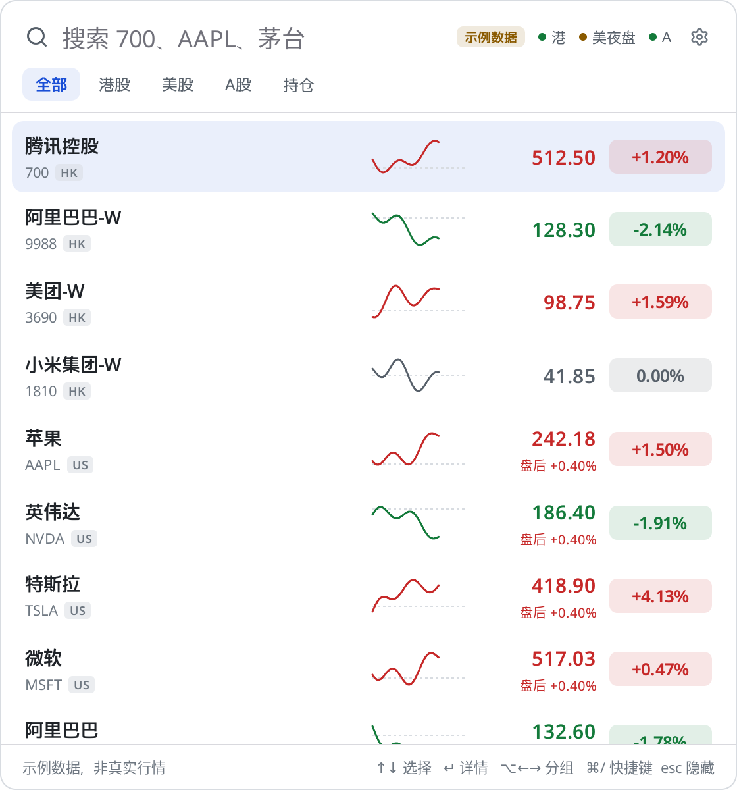 | 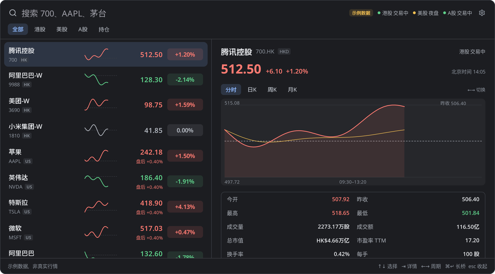 |

| AI 解读 · 解读今日走势（浅色） | AI 解读（深色） |
|---|---|
| 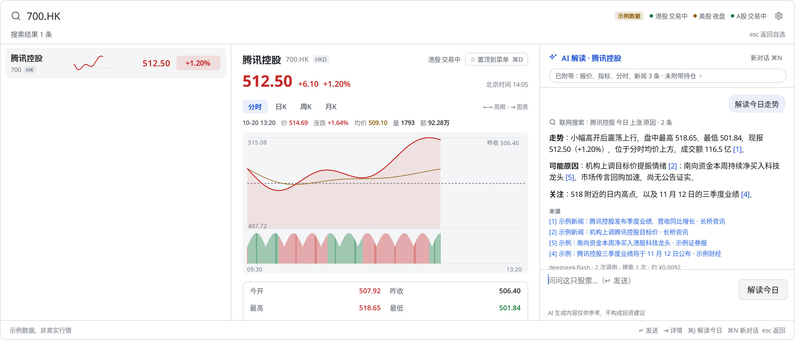 | 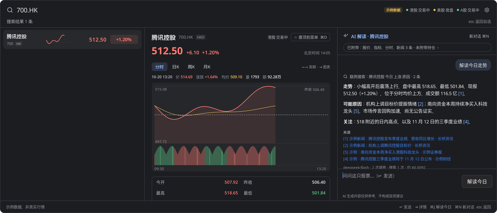 |

| K 线十字光标（浅色） | 分时十字光标（深色） |
|---|---|
| 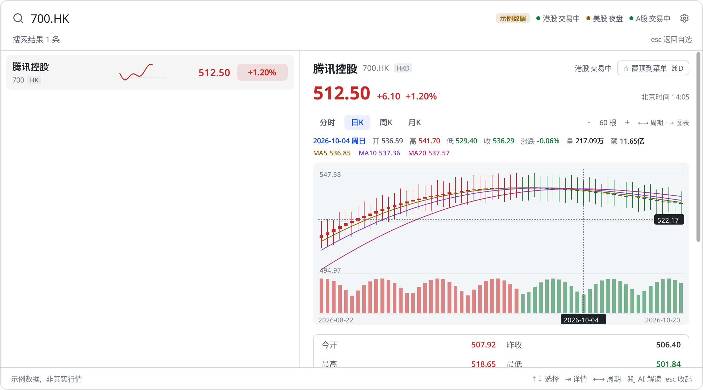 | 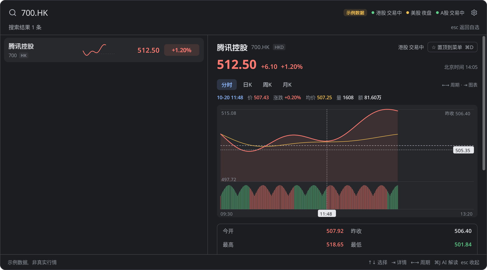 |

| 菜单栏菜单（示意图） | 持仓 · 按美元合计 | 设置 › AI |
|---|---|---|
| 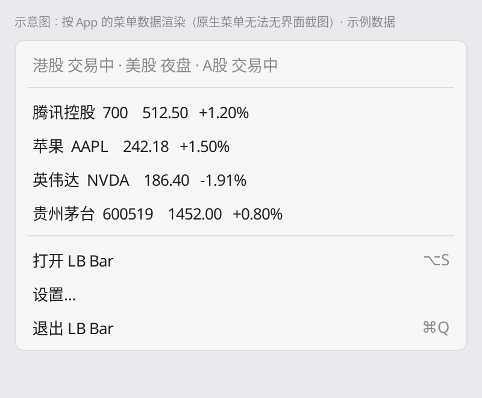 | 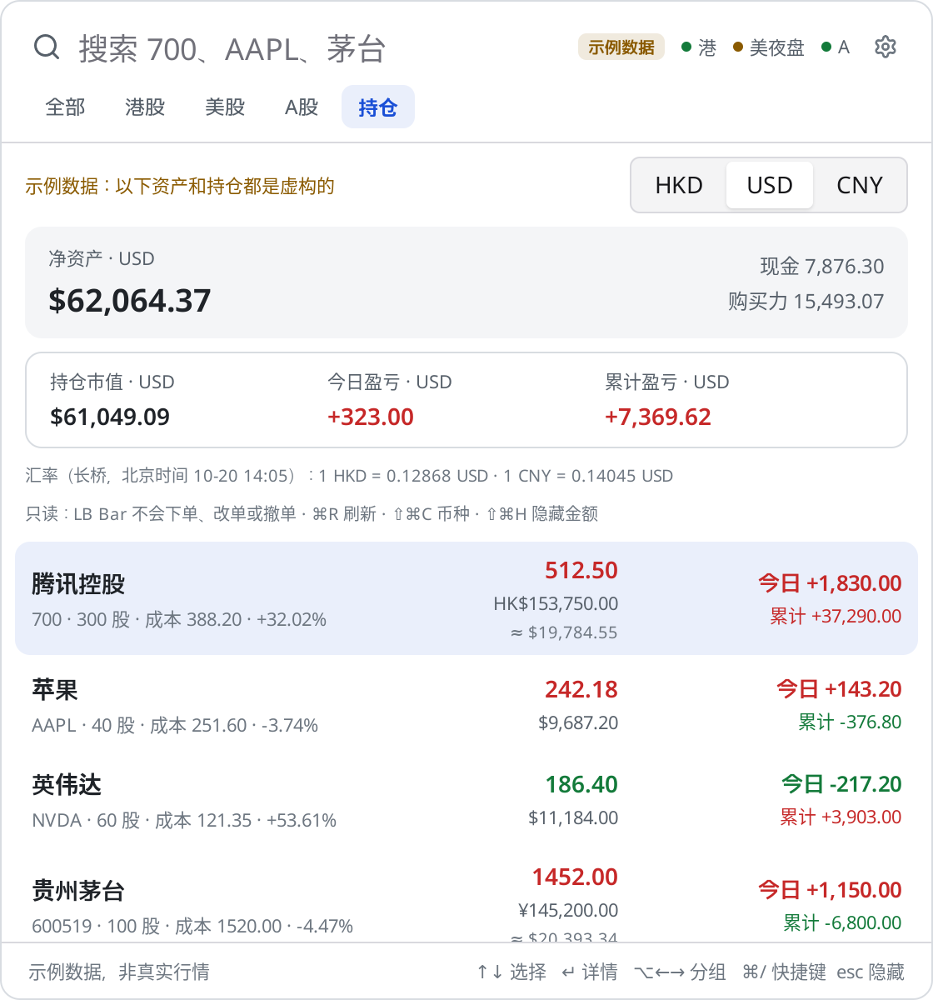 | 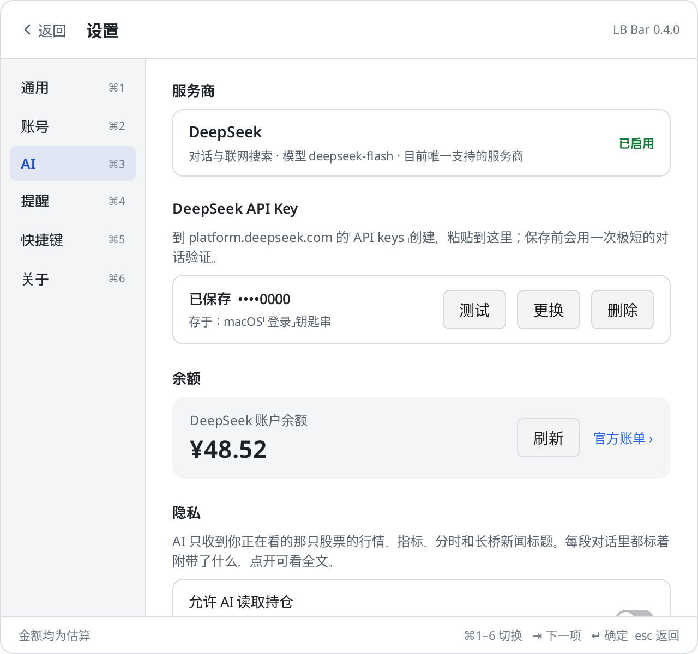 |

| Linux（Xvfb + Openbox 里真实运行的 Linux 版截图，示例数据） | Windows 版的按键与文字（测试渲染，示例数据） |
|---|---|
| 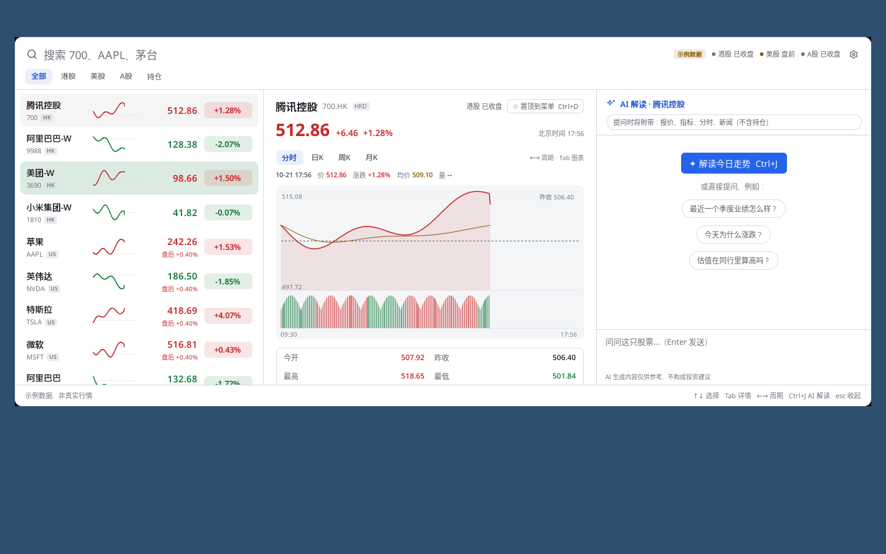 | 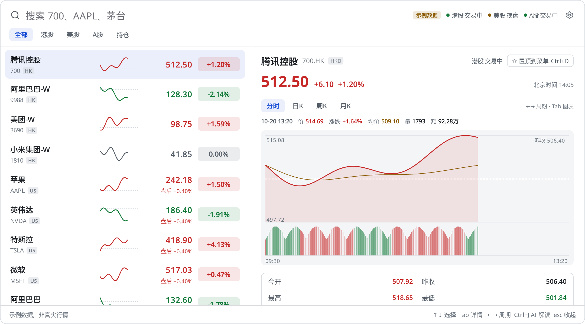 |

截图里的行情、新闻、资产、持仓、汇率和 AI 回答都是**示例数据**（`feed.Mock` 与脚本化的假 AI），不是真实行情、真实账户或真实 AI 输出；界面上也标着「示例数据」。macOS 原生菜单无法在无界面环境截图，菜单那张是按 App 的菜单数据渲染的示意图。Linux 那张是 Linux 版在虚拟显示（Xvfb，无合成器，所以圆角外露出黑角）里实际运行的截图；其余截图由测试离屏渲染。

## 功能

- **菜单栏行情**（macOS；Linux 上部分面板显示，见下）：如 `腾讯控股 512.50 +1.20%`，实时推送更新（最多每秒一次）。在常用股票之间轮播（默认 5 秒），可显示代码代替名称，可只显示图标。macOS 菜单栏文字只能单色，可选在前面加 🔴/🟢 圆点表示涨跌。
- **菜单栏 / 托盘菜单**：点图标，第一行是市场状态，下面是**常用股票**（名称代码、现价、涨跌幅，跟着推送更新），点一只直接打开面板到它的详情；然后是「打开 LB Bar ⌥S」「设置…」「退出 LB Bar ⌘Q」。常用股票最多 8 只，在「设置 › 通用 › 常用股票」搜索添加、上移下移、移除，或在面板里选中按 ⌘D（详情顶部也有「置顶到菜单」按钮）。默认为空，菜单里有添加提示。
- **涨跌颜色**：红涨绿跌（默认）或绿涨红跌，面板、图表、圆点一起变。
- **自选**：从长桥 App 的自选分组同步，分组做成标签页；每行名称、代码、现价、涨跌幅、当日迷你分时线，推送到达时整行轻微闪一下。美股在盘前 / 盘后 / 夜盘时多一行扩展时段涨跌。
- **搜索**：直接打字。代码（`700`、`00700`、`AAPL`、`600519`、`300750`）用 API 校验；名称在自选、持仓、长桥美股证券列表（约 1.2 万只）和内置常用别名（`tencent`、`茅台`、`apple`、`英伟达`…）里找。
- **详情**（↵）：分时（价格、均价、昨收虚线、成交量）和日 K / 周 K / 月 K（蜡烛、成交量副图、MA5 / MA10 / MA20），原生绘制；今开、最高、最低、昨收、成交量、成交额、总市值、市盈率 TTM、换手率、每手；美股盘前盘后；最新新闻。⌘↵ 在长桥网页打开。
- **图表十字光标**：鼠标悬停显示竖线和横线、纵轴价格标签、横轴日期 / 时间标签，图表上方显示那一根的开高低收、涨跌幅、成交量 / 额和 MA 值（分时显示时间、价格、均价、涨跌、量、额）。⇥ 把焦点移到图表后：← → 逐根移动（到最左继续往前翻），Home / End 第一根 / 最后一根，+ / − 或 ⌘= / ⌘- 切换显示 30 / 60 / 120 / 250 根（最多取 300 根），esc 清除。
- **持仓（只读）**：净资产、现金、购买力，以及持仓市值、今日盈亏、累计盈亏的合计，可按 **HKD / USD / CNY** 显示（点切换或 ⇧⌘C，记住选择）；换算用长桥的汇率，并写明汇率与读取时间（北京时间）。每只持仓仍以原币显示数量、成本、市值、盈亏，非合计币种时另附约合金额。汇率读不到时按原币分别合计。⇧⌘H 隐藏所有金额。
- **面板可拖动**：拖顶部（搜索栏、分组标签）或底部提示栏的空白处移动面板，每块屏幕分别记住位置；位置不在屏幕内时回到默认。双击顶部 / 底部空白处，或「设置 › 通用 › 面板位置 › 恢复默认位置」复位。
- **价格提醒**：价格高于 / 低于、涨幅 / 跌幅达到，满足时发系统通知（macOS 通知中心、Windows 通知、Linux 桌面通知）；可设一次性或重复（回落后再次满足，间隔至少 5 分钟）。规则保存在本机。
- **市场状态**：港股 / 美股 / A 股 交易中、盘前、午休、盘后、夜盘、已收盘，时间都按北京时间。
- **AI 解读**（DeepSeek，模型 deepseek-flash）：展开详情时右侧是 AI 栏，针对正在看的股票自由提问。每段对话开头自动附带：名称代码、实时报价（含美股盘前盘后夜盘）、关键指标（市值、市盈率、市净率、换手率、每股收益…）、分时摘要（高低点及时间、均价、半小时采样）、长桥最近 5 条新闻（带日期）。模型可调用 DeepSeek 联网搜索，每轮最多 2 次；回答用 [n] 标注来源，点击打开原文，回答下方列出所引来源，并显示调用次数与估算费用。顶部小标签写明附带了什么（如「已附带：报价、指标、分时、新闻 5 条 · 未附带持仓」），点开可看发送的全文。追问会自动带上最新价。每只股票一段对话，只在内存里。
- **解读今日走势**：⌘J 或按钮，一键解读（走势特征、可能原因并区分证实与推测、关注点），不用打字。
- **设置 › AI**：服务商（目前只有 DeepSeek）、API Key、余额、隐私开关，下方是**用量与费用**：今日 / 本月 / 累计估算花费、近 30 天柱状图。
- **凭证**：存系统凭据库（macOS 钥匙串、Windows 凭据管理器、Linux Secret Service；三项一条记录），保存后只显示末 4 位，可「更换」「删除」；读出 Access Token 的到期时间，到期前 14 天面板顶部提示，前 7 天每天一次通知。

## 安装

从 [Releases](https://github.com/horizon0514/lb-bar/releases) 下载对应系统的文件；`SHA256SUMS.txt` 里是各文件的 SHA-256。

### macOS（12 或更高）

1. 下载 `LB-Bar-<版本>-macos-universal.zip`（Apple Silicon 与 Intel 通用），解压，把 `LB Bar.app` 拖进「应用程序」。
2. App 是 ad-hoc 签名、未经 Apple 公证：第一次打开时右键 › 打开，或者
   `xattr -dr com.apple.quarantine "/Applications/LB Bar.app"`。
3. 打开后进入「设置 › 账号」，填入凭证（见下）。之后 ⌥S 唤起面板。

### Windows 10 / 11（x64 或 ARM64）

- **安装版**：运行 `LB-Bar-<版本>-windows-amd64-setup.exe`（ARM 电脑用 `-arm64-setup.exe`），装到当前用户（`%LOCALAPPDATA%\Programs\LB Bar`，不需要管理员权限），开始菜单里有 LB Bar，可在「设置 › 应用」里卸载。
- **免安装版**：解压 `LB-Bar-<版本>-windows-amd64-portable.zip`，运行 `LB Bar\LB Bar.exe`。
- 程序**没有代码签名**，第一次运行时 SmartScreen 会提示「Windows 已保护你的电脑」：点「更多信息 › 仍要运行」。（浏览器也可能提示下载的文件不常见，选「保留」。）
- 图标在任务栏右下角的通知区域（可能在「^」隐藏的图标里，可拖到任务栏上常显示）。点图标打开菜单：常用股票价格、打开 LB Bar、设置、退出；悬停图标显示市场状态和常用股票价格。面板默认在通知区域旁边弹出（右下角），拖动后记住位置。
- 唤起快捷键默认 **Alt+Shift+S**（被占用时自动改用 Alt+Shift+L，可在设置里改）。

### Linux（x64 或 ARM64）

- **Debian / Ubuntu**：`sudo apt install ./lb-bar_<版本>_amd64.deb`（ARM64 用 `_arm64.deb`），装到 `/opt/lb-bar`，应用菜单里有 LB Bar。
- **其他发行版**：解压 `lb-bar-<版本>-linux-amd64.tar.gz`，运行其中的 `./install.sh`，装到 `~/.local`（不需要 root）。
- 需要 GTK 3（deb 会自动安装依赖）。托盘图标需要 `libayatana-appindicator3-1` 和支持 StatusNotifier / AppIndicator 的面板：KDE、Xfce、Cinnamon、Ubuntu 自带；原版 GNOME 需装「AppIndicator and KStatusNotifierItem Support」扩展。没有托盘时用快捷键唤起面板。
- 凭证存 Secret Service（GNOME Keyring、KWallet 等，需要 `libsecret-1-0`）；没有密钥环的系统自动改存本地文件 `~/.config/lb-bar/credentials`（0600）。
- 唤起快捷键默认 **Alt+Shift+S**（被占用时改用 Alt+Shift+L）。X11 下直接生效；Wayland 下通过 XDG 桌面门户的 GlobalShortcuts 注册（需要桌面支持该门户，且 App 已安装），桌面可能会请你确认。

## 获取长桥 OpenAPI 凭证

1. 登录 [open.longbridge.com](https://open.longbridge.com/)（用长桥账户），在「用户中心 › 应用凭证」开通 OpenAPI。
2. 复制 **App Key**、**App Secret**、**Access Token**，粘贴到 LB Bar「设置 › 账号」，点「验证并保存」。LB Bar 会先连一次长桥验证，通过才保存。
3. Access Token 有有效期（以开发者中心显示为准）。LB Bar 从 Token 本身读出到期时间并提醒；到期后在开发者中心重新生成，再到「设置 › 账号 › 更换」。
4. 行情权限取决于你的长桥账户（例如美股 LV1 实时、港股 BMP / LV2）。权限不够时价格可能延时或无推送。
5. 线路：默认「中国大陆线路」（`*.longbridge.cn`），连不上时在「设置 › 通用 › 连接」换「全球线路」。

也可以用环境变量（开发时）：`LONGPORT_APP_KEY`、`LONGPORT_APP_SECRET`、`LONGPORT_ACCESS_TOKEN`（或 `LONGBRIDGE_*`）。

## 快捷键

按 Mac 写；Windows / Linux 上 ⌘ → Ctrl、⌥ → Alt、⇧ → Shift，唤起面板默认是 Alt+Shift+S。

| 键 | 作用 |
|---|---|
| ⌥S | 唤起 / 隐藏面板（设置里可改；被占用时退到 ⌥⇧S） |
| 直接打字 | 搜索：代码、中英文名称，如 700、AAPL、茅台、tencent |
| ↑ ↓ | 选择 |
| ↵ | 看详情（分时 / K 线 / 新闻） |
| ⌘↵ | 在长桥网页打开 |
| ⇥ / ⇧⇥ | 列表 → 详情 → 图表 → AI 栏 之间切换 / 往回 |
| 图表里 ← → | 十字光标逐根移动（到最左继续往前翻） |
| 图表里 Home End | 第一根 / 最后一根 |
| 图表里 + − | K 线放大 / 缩小 |
| 图表里 esc | 清除十字光标（再按回到详情） |
| ⌘= ⌘- | K 线放大 / 缩小（30 / 60 / 120 / 250 根） |
| ⌘J | 解读今日走势（任何时候，在选中的股票上） |
| AI 栏里 ↵ / ⇧↵ | 发送 / 换行；空白时 ↑ 取回上一个问题 |
| AI 栏里 ⌘N | 新对话 |
| AI 栏里 esc | 回到详情 |
| ← → | 详情里切换 分时 / 日K / 周K / 月K |
| ⌥← ⌥→ 或 ⌃⇥ | 切换自选分组 |
| ⌘1 … ⌘9 | 第 N 个分组 |
| ⌘P | 持仓（只读） |
| ⌘D | 置顶到菜单（常用股票，最多 8 只）/ 取消 |
| ⌘N | 为选中的股票加价格提醒（在 AI 栏里是新对话） |
| ⌘C | 复制代码 |
| ⌘L | 回到搜索框 |
| ⌘R | 刷新 |
| ⇧⌘H | 隐藏 / 显示金额 |
| ⇧⌘C | 持仓合计币种 HKD → USD → CNY |
| esc | 收起详情 › 清空搜索 › 隐藏面板 |
| ⌘, | 设置（⌘1–⌘6：通用、账号、AI、提醒、快捷键、关于） |
| 拖动顶部 / 底部空白 | 移动面板（双击复位） |
| ⌘/ | 快捷键表 |
| ⌘Q | 退出（菜单栏菜单里也有「退出 LB Bar」） |

## 数据与隐私

- 数据目录：macOS `~/Library/Application Support/LB Bar/`，Windows `%APPDATA%\LB Bar\`，Linux `~/.config/lb-bar/`（`$XDG_CONFIG_HOME/lb-bar`）。里面有设置 `config.json`、价格提醒 `alerts.json`、AI 用量 `usage.json`。
- 凭证：系统凭据库里一条记录（服务 `dev.horizon.lbbar`，账户名 `longbridge-credentials`）：macOS「登录」钥匙串、Windows 凭据管理器（普通凭据 `dev.horizon.lbbar/longbridge-credentials`）、Linux Secret Service。也可在设置里改存数据目录里的本地文件 `credentials`（Unix 上权限 0600；Windows 上依赖 `%APPDATA%` 的用户权限；无系统加密）。
- 长桥凭证只发给长桥 OpenAPI。DeepSeek API Key 单独存凭据库（账户名 `deepseek-api-key`，或本地文件 `deepseek-key`，0600；也读环境变量 `DEEPSEEK_API_KEY`），只发给 `api.deepseek.com`。除这两家外不连接其他服务器，没有统计或遥测。
- **发给 AI 的内容**：只在你提问时发送，只有正在看的那只股票的报价、指标、分时摘要和长桥新闻标题，以及你的问题。**持仓默认不发送**；在「设置 › AI」打开「允许 AI 读取持仓」后，新对话才附带持仓（代码、数量、成本、现价、市值、盈亏）。现金、净资产、购买力**从不发送**。AI 栏顶部标签总是写明附带了什么。
- AI 用量账本 `usage.json` 只记次数与金额，不记问题和回答。
- AI 生成内容仅供参考，不构成投资建议；AI 只有「联网搜索」一个工具，不能下单。
- 只调用这些接口：自选分组、证券静态信息、实时报价与推送订阅、计算指标、分时、K 线、交易时段、市场状态、新闻、美股证券列表；交易接口只用「股票持仓」和「账户资金」两个查询，资产接口只用「汇率」查询。**没有下单、改单、撤单的代码**（`TestNoTradingCalls` 检查）。

## 关于频率限制

长桥 OpenAPI 限制约每秒 10 次、同时 5 个请求，订阅最多 500 只。LB Bar：

- 实时价格全部走 WebSocket 推送订阅，不轮询；推送在主线程按 150 ms 批量合并。
- 所有请求经过本地令牌桶（每秒 8 次，突发 4，同时 4 个）；批量接口按 500 只一批。
- 订阅按优先级取前 500 只：菜单栏的、有提醒的、当前分组、持仓、正在看详情的、其他分组。
- 断线由 SDK 自动重连并重新订阅；LB Bar 重连后补一次快照。每 5 分钟补一次快照防止漏推。
- 迷你分时线每只 10 分钟最多取一次，之后由推送续上。

## 已知限制

- 长桥 OpenAPI 没有按名称模糊搜索的接口：名称搜索只覆盖自选、持仓、美股证券列表和内置别名；港股 / A 股不在自选里的，请输代码。
- macOS 菜单栏文字不能着色，只能用 🔴/🟢 圆点表示涨跌。
- **菜单栏文字只在 macOS 上有。** Windows 的通知区域只显示图标：价格在悬停提示（最多 127 个字符）和图标菜单里。Linux 上文字用 AppIndicator 标签显示，只有部分面板（如 Ubuntu）会显示；悬停提示和菜单里总有价格。
- Linux 的托盘不报告点击位置，面板默认在屏幕上方居中；Windows 的面板默认贴着通知区域。
- Windows 版未签名（SmartScreen 警告）；macOS 版 ad-hoc 签名、未公证。
- Linux 的 X11 下若没有合成器，面板圆角外会露出黑角。Wayland 下窗口位置由合成器决定，面板不一定出现在记住的位置。
- 首次在 Linux 上保存凭证时，密钥环可能弹窗要求创建或解锁；在没有图形会话的环境（如 SSH）里请改用本地文件。
- ⌘↵ 打开长桥网页行情页（`longbridge.com/zh-CN/quote/<代码>`）；长桥 App 没有公开的深链接。
- 市场状态来自 API，取不到时按本地时间表推算（不含节假日）。API 的状态不含美股夜盘，夜盘时段按时间表显示。
- 港股 BMP 权限的推送可能不是逐笔实时，取决于账户行情权限。
- 价格提醒只在 LB Bar 运行时检查。
- AI 费用是按官方价格的本机估算（联网搜索每次 ¥0.005；deepseek-flash 按 token，北京时间工作日 9–12、14–18 点为高峰价，其余半价），以 DeepSeek 账单为准。实测一个典型问题（1 轮附带上下文、2 次搜索）约 ¥0.03（高峰价），空闲时段约 ¥0.02。
- AI 对话不保存，退出即清空；联网搜索结果的质量和时效取决于 DeepSeek 搜索。
- 图表不支持滚轮 / 触控板缩放和拖动平移（界面框架没有给元素的滚轮事件）；用 + − / ⌘= ⌘- 切换根数，← 到最左继续往前翻，最多 300 根。
- 菜单打开期间价格照常更新，但 macOS 菜单没有「将要打开」的通知，菜单文字最多每秒刷新一次。
- 汇率随持仓一起读取（打开持仓、⌘R 刷新时），不是实时汇率；合计是按汇率换算的近似值，以长桥 App 为准。
- 面板位置按屏幕的名称和分辨率记住；改了分辨率会当作新屏幕，回到默认位置。

## 从源码构建

需要 Go 1.27+；不需要 cgo，任何系统都能编译所有平台。

```sh
CGO_ENABLED=0 go test -short ./...          # 单元测试（模拟数据）
go tool mygo vet .
LBBAR_DEMO=1 go tool mygo dev               # 示例数据模式，不需要凭证
go tool mygo build -platform darwin/universal,windows/amd64,windows/arm64,linux/amd64,linux/arm64 -skip-dmg
scripts/package.sh                          # 签名 macOS 版并把各平台文件放进 build/dist/
```

`scripts/package.sh` 会调用 `scripts/sign.sh`；Windows 安装包需要 NSIS（Linux 上 `apt install nsis`，在 Windows 上 mygo 会自动下载）。`scripts/screenshot-linux.sh build/linux-amd64/lb-bar out/` 在 Xvfb 里运行 Linux 版并截图（示例数据）。

### 发布（GitHub Actions）

- `.github/workflows/ci.yml`：每次 push / PR 在 macOS、Windows、Linux x64、Linux arm64 上 vet + 测试，并在 Linux 上交叉检查所有平台。
- `.github/workflows/release.yml`：推送 `v*` 标签（或手动 workflow_dispatch）时，每个系统在自己的 runner 上测试、构建、打包、截图，上传为 artifacts；标签推送时再创建（或更新）同名 GitHub Release，附上所有文件和 `SHA256SUMS.txt`。标签必须和 `mygo.json` 与 `main.go` 的版本一致。不需要任何 secret。

`scripts/sign.sh` 用固定的签名标识和只认标识的 designated requirement 做 ad-hoc 签名，这样更新后 macOS 仍认为是同一个 App，钥匙串里的凭证不必重新授权（不在 macOS 上时用 [rcodesign](https://github.com/indygreg/apple-platform-rs)）。

### 测试

- `go test -short ./...`：模拟数据（`feed.Mock`）上的界面流程、按键、推送批量与闪烁、重连、提醒、格式化、搜索、钥匙串、Token 到期、市场时段、对比度。
- `go test ./...`：另外渲染浅色 / 深色截图到 `shots/`（`LBBAR_DOCS=1` 时同时写 `docs/screenshots/`），包括按 Windows / Linux 的按键和文字渲染的版本。
- `LBBAR_KEYRING=1 go test -run TestSystemKeyring .`：用本机真实的凭据库（钥匙串 / 凭据管理器 / Secret Service）写入、读回、删除一条测试记录。
- 设置了 `LONGPORT_APP_KEY` / `LONGPORT_APP_SECRET` / `LONGPORT_ACCESS_TOKEN` 时，`TestRealAPI` 与 `TestRealApp` 会连真实长桥（只读）：自选、静态信息、报价、指标、分时、K 线、订阅推送、市场状态、新闻、证券列表、持仓与资金（只记录数量，不记录金额）、汇率、300 根日 K。`TestRealApp` 还会把真实自选和 K 线十字光标渲染到 `shots/real-*.png`（不含资产和持仓），并检查菜单常用股票的实时价格和持仓的三币种换算（只记录汇率，不记录金额）。再设置 `DEEPSEEK_API_KEY` 时，`TestRealAI` 会对真实自选里的股票提一个需要联网搜索的问题并跑一次「解读今日走势」（持仓保持关闭），记录调用次数和费用，回答写到 `shots/real-ai.md`。`LBBAR_REGION=global` 改走全球线路。

## 许可

MIT，见 [LICENSE](LICENSE)。依赖的许可见 [THIRD_PARTY_NOTICES.md](THIRD_PARTY_NOTICES.md)。
