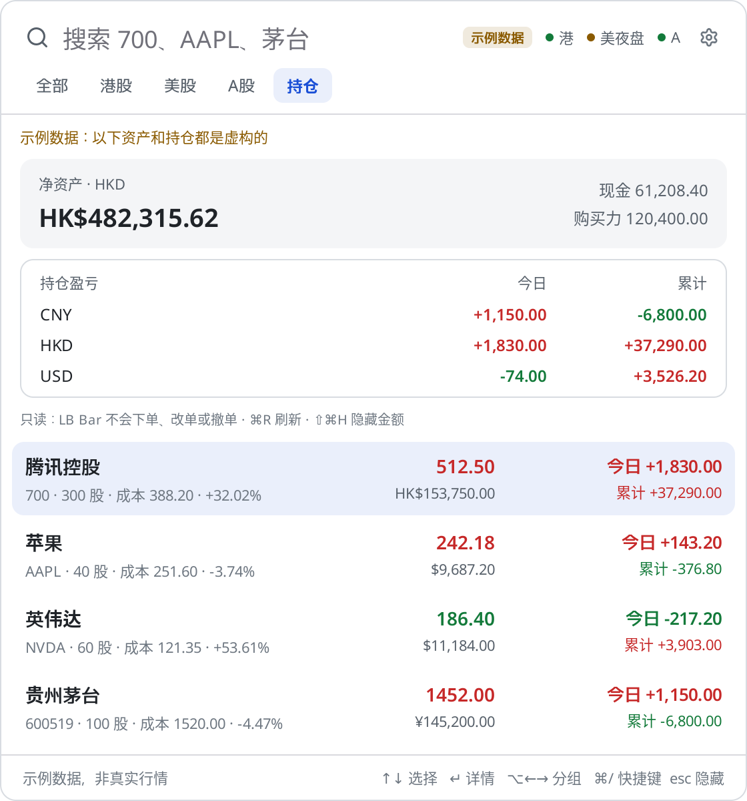
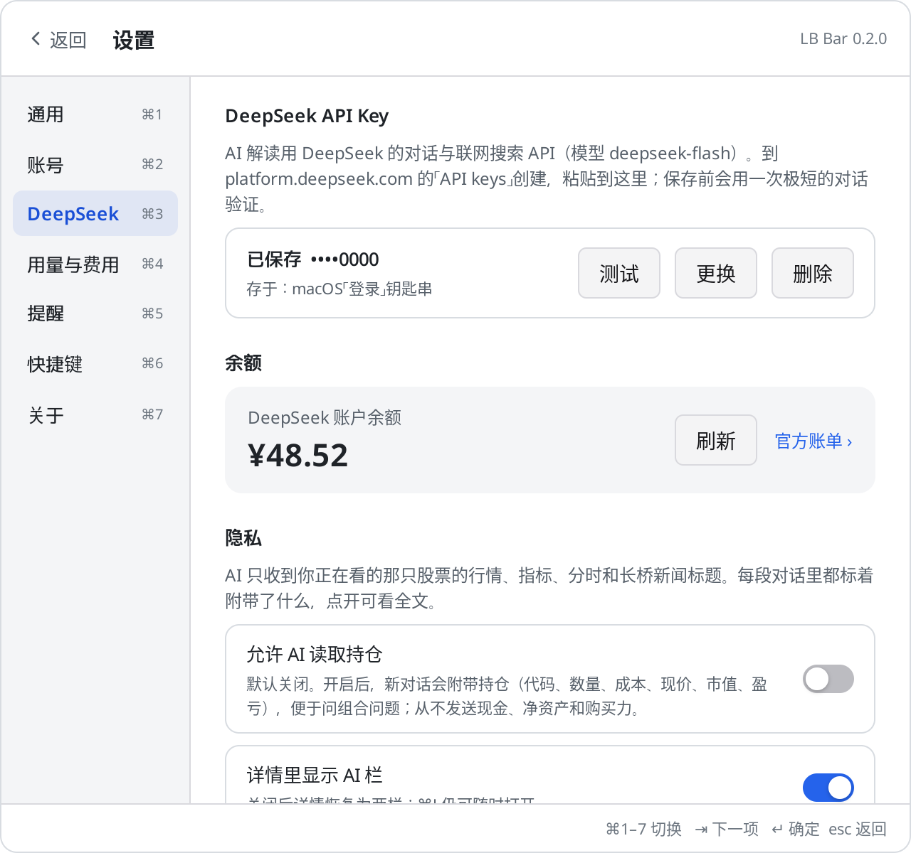

# LB Bar · 长桥行情栏

菜单栏里的长桥（Longbridge）行情：菜单栏常驻一只股票的实时价格，**⌥S** 随时唤起面板，看自选股实时推送、分时 / K 线、关键指标和新闻，只读查看持仓，本机价格提醒，以及 **DeepSeek AI 解读**（问任意问题、⌘J 一键解读今日走势，可联网搜索并标注来源）。原生 macOS 界面（[MyGo](https://github.com/egoist/mygo)，纯 Go），全键盘操作。

> 非长桥官方产品。数据来自 [长桥 OpenAPI](https://open.longbridge.com/)，需要你自己的 OpenAPI 凭证。**只读：从不下单、改单或撤单。**

| 自选（浅色） | 详情（深色） |
|---|---|
|  |  |

| AI 解读 · 解读今日走势（浅色） | AI 解读（深色） |
|---|---|
|  |  |

| 持仓（只读） | 设置 › DeepSeek |
|---|---|
|  |  |

截图里的行情、新闻、资产、持仓和 AI 回答都是**示例数据**（`feed.Mock` 与脚本化的假 AI），不是真实行情、真实账户或真实 AI 输出；界面上也标着「示例数据」。

## 功能

- **菜单栏行情**：如 `腾讯控股 512.50 +1.20%`，实时推送更新（最多每秒一次）。可固定多只轮播（默认 5 秒），可显示代码代替名称，可只显示图标。macOS 菜单栏文字只能单色，可选在前面加 🔴/🟢 圆点表示涨跌。
- **涨跌颜色**：红涨绿跌（默认）或绿涨红跌，面板、图表、圆点一起变。
- **自选**：从长桥 App 的自选分组同步，分组做成标签页；每行名称、代码、现价、涨跌幅、当日迷你分时线，推送到达时整行轻微闪一下。美股在盘前 / 盘后 / 夜盘时多一行扩展时段涨跌。
- **搜索**：直接打字。代码（`700`、`00700`、`AAPL`、`600519`、`300750`）用 API 校验；名称在自选、持仓、长桥美股证券列表（约 1.2 万只）和内置常用别名（`tencent`、`茅台`、`apple`、`英伟达`…）里找。
- **详情**（↵）：分时（价格、均价、昨收虚线）和日 K / 周 K / 月 K，原生绘制；今开、最高、最低、昨收、成交量、成交额、总市值、市盈率 TTM、换手率、每手；美股盘前盘后；最新新闻。⌘↵ 在长桥网页打开。
- **持仓（只读）**：每个币种的净资产、现金、购买力；每只持仓的数量、成本、市值、今日盈亏、累计盈亏。⇧⌘H 隐藏所有金额。
- **价格提醒**：价格高于 / 低于、涨幅 / 跌幅达到，满足时发 macOS 通知；可设一次性或重复（回落后再次满足，间隔至少 5 分钟）。规则保存在本机。
- **市场状态**：港股 / 美股 / A 股 交易中、盘前、午休、盘后、夜盘、已收盘，时间都按北京时间。
- **AI 解读**（DeepSeek，模型 deepseek-flash）：展开详情时右侧是 AI 栏，针对正在看的股票自由提问。每段对话开头自动附带：名称代码、实时报价（含美股盘前盘后夜盘）、关键指标（市值、市盈率、市净率、换手率、每股收益…）、分时摘要（高低点及时间、均价、半小时采样）、长桥最近 5 条新闻（带日期）。模型可调用 DeepSeek 联网搜索，每轮最多 2 次；回答用 [n] 标注来源，点击打开原文，回答下方列出所引来源，并显示调用次数与估算费用。顶部小标签写明附带了什么（如「已附带：报价、指标、分时、新闻 5 条 · 未附带持仓」），点开可看发送的全文。追问会自动带上最新价。每只股票一段对话，只在内存里。
- **解读今日走势**：⌘J 或按钮，一键解读（走势特征、可能原因并区分证实与推测、关注点），不用打字。
- **用量与费用**：设置 › 用量与费用，今日 / 本月 / 累计估算花费、近 30 天柱状图、DeepSeek 余额。
- **凭证**：存 macOS 钥匙串（三项一条记录，只需授权一次），保存后只显示末 4 位，可「更换」「删除」；读出 Access Token 的到期时间，到期前 14 天面板顶部提示，前 7 天每天一次通知。

## 安装

1. 下载 `LB-Bar-0.2.0-macos-universal.zip`（Apple Silicon 与 Intel 通用），解压，把 `LB Bar.app` 拖进「应用程序」。
2. App 是 ad-hoc 签名、未经 Apple 公证：第一次打开时右键 › 打开，或者
   `xattr -dr com.apple.quarantine "/Applications/LB Bar.app"`。
3. 打开后进入「设置 › 账号」，填入凭证（见下）。之后 ⌥S 唤起面板。

需要 macOS 12 或更高。

## 获取长桥 OpenAPI 凭证

1. 登录 [open.longbridge.com](https://open.longbridge.com/)（用长桥账户），在「用户中心 › 应用凭证」开通 OpenAPI。
2. 复制 **App Key**、**App Secret**、**Access Token**，粘贴到 LB Bar「设置 › 账号」，点「验证并保存」。LB Bar 会先连一次长桥验证，通过才保存。
3. Access Token 有有效期（以开发者中心显示为准）。LB Bar 从 Token 本身读出到期时间并提醒；到期后在开发者中心重新生成，再到「设置 › 账号 › 更换」。
4. 行情权限取决于你的长桥账户（例如美股 LV1 实时、港股 BMP / LV2）。权限不够时价格可能延时或无推送。
5. 线路：默认「中国大陆线路」（`*.longbridge.cn`），连不上时在「设置 › 通用 › 连接」换「全球线路」。

也可以用环境变量（开发时）：`LONGPORT_APP_KEY`、`LONGPORT_APP_SECRET`、`LONGPORT_ACCESS_TOKEN`（或 `LONGBRIDGE_*`）。

## 快捷键

| 键 | 作用 |
|---|---|
| ⌥S | 唤起 / 隐藏面板（设置里可改；被占用时退到 ⌥⇧S） |
| 直接打字 | 搜索：代码、中英文名称，如 700、AAPL、茅台、tencent |
| ↑ ↓ | 选择 |
| ↵ | 看详情（分时 / K 线 / 新闻） |
| ⌘↵ | 在长桥网页打开 |
| ⇥ / ⇧⇥ | 列表 → 详情 → AI 栏 之间切换 / 回列表 |
| ⌘J | 解读今日走势（任何时候，在选中的股票上） |
| AI 栏里 ↵ / ⇧↵ | 发送 / 换行；空白时 ↑ 取回上一个问题 |
| AI 栏里 ⌘N | 新对话 |
| AI 栏里 esc | 回到详情 |
| ← → | 详情里切换 分时 / 日K / 周K / 月K |
| ⌥← ⌥→ 或 ⌃⇥ | 切换自选分组 |
| ⌘1 … ⌘9 | 第 N 个分组 |
| ⌘P | 持仓（只读） |
| ⌘D | 把选中的股票固定到菜单栏 / 取消 |
| ⌘N | 为选中的股票加价格提醒（在 AI 栏里是新对话） |
| ⌘C | 复制代码 |
| ⌘L | 回到搜索框 |
| ⌘R | 刷新 |
| ⇧⌘H | 隐藏 / 显示金额 |
| esc | 收起详情 › 清空搜索 › 隐藏面板 |
| ⌘, | 设置（⌘1–⌘7：通用、账号、DeepSeek、用量与费用、提醒、快捷键、关于） |
| ⌘/ | 快捷键表 |
| ⌘Q | 退出（菜单栏菜单里也有「退出 LB Bar」） |

## 数据与隐私

- 设置：`~/Library/Application Support/LB Bar/config.json`；价格提醒：同目录 `alerts.json`。
- 凭证：macOS「登录」钥匙串，一条记录（账户名 `longbridge-credentials`）。也可在设置里改存本地文件（`credentials`，权限 0600，无系统加密）。
- 长桥凭证只发给长桥 OpenAPI。DeepSeek API Key 单独存钥匙串（账户名 `deepseek-api-key`，或本地文件 `deepseek-key`，0600；也读环境变量 `DEEPSEEK_API_KEY`），只发给 `api.deepseek.com`。除这两家外不连接其他服务器，没有统计或遥测。
- **发给 AI 的内容**：只在你提问时发送，只有正在看的那只股票的报价、指标、分时摘要和长桥新闻标题，以及你的问题。**持仓默认不发送**；在「设置 › DeepSeek」打开「允许 AI 读取持仓」后，新对话才附带持仓（代码、数量、成本、现价、市值、盈亏）。现金、净资产、购买力**从不发送**。AI 栏顶部标签总是写明附带了什么。
- AI 用量账本 `usage.json` 只记次数与金额，不记问题和回答。
- AI 生成内容仅供参考，不构成投资建议；AI 只有「联网搜索」一个工具，不能下单。
- 只调用这些接口：自选分组、证券静态信息、实时报价与推送订阅、计算指标、分时、K 线、交易时段、市场状态、新闻、美股证券列表；交易接口只用「股票持仓」和「账户资金」两个查询。**没有下单、改单、撤单的代码**（`TestNoTradingCalls` 检查）。

## 关于频率限制

长桥 OpenAPI 限制约每秒 10 次、同时 5 个请求，订阅最多 500 只。LB Bar：

- 实时价格全部走 WebSocket 推送订阅，不轮询；推送在主线程按 150 ms 批量合并。
- 所有请求经过本地令牌桶（每秒 8 次，突发 4，同时 4 个）；批量接口按 500 只一批。
- 订阅按优先级取前 500 只：菜单栏的、有提醒的、当前分组、持仓、正在看详情的、其他分组。
- 断线由 SDK 自动重连并重新订阅；LB Bar 重连后补一次快照。每 5 分钟补一次快照防止漏推。
- 迷你分时线每只 10 分钟最多取一次，之后由推送续上。

## 已知限制

- 长桥 OpenAPI 没有按名称模糊搜索的接口：名称搜索只覆盖自选、持仓、美股证券列表和内置别名；港股 / A 股不在自选里的，请输代码。
- macOS 菜单栏文字不能着色，只能用 🔴/🟢 圆点表示涨跌。
- ⌘↵ 打开长桥网页行情页（`longbridge.com/zh-CN/quote/<代码>`）；长桥 App 没有公开的深链接。
- 市场状态来自 API，取不到时按本地时间表推算（不含节假日）。API 的状态不含美股夜盘，夜盘时段按时间表显示。
- 港股 BMP 权限的推送可能不是逐笔实时，取决于账户行情权限。
- 价格提醒只在 LB Bar 运行时检查。
- AI 费用是按官方价格的本机估算（联网搜索每次 ¥0.005；deepseek-flash 按 token，北京时间工作日 9–12、14–18 点为高峰价，其余半价），以 DeepSeek 账单为准。实测一个典型问题（1 轮附带上下文、2 次搜索）约 ¥0.03（高峰价），空闲时段约 ¥0.02。
- AI 对话不保存，退出即清空；联网搜索结果的质量和时效取决于 DeepSeek 搜索。

## 从源码构建

需要 Go 1.27+。

```sh
CGO_ENABLED=0 go test -short ./...          # 单元测试（模拟数据）
go tool mygo vet .
LBBAR_DEMO=1 go tool mygo dev               # 示例数据模式，不需要凭证
go tool mygo build -platform darwin/universal
scripts/sign.sh                             # ad-hoc 签名，固定标识 dev.horizon.lbbar
cd build/darwin-universal && zip -qry ../LB-Bar-0.2.0-macos-universal.zip "LB Bar.app"
```

`scripts/sign.sh` 用固定的签名标识和只认标识的 designated requirement 做 ad-hoc 签名，这样更新后 macOS 仍认为是同一个 App，钥匙串里的凭证不必重新授权（不在 macOS 上时用 [rcodesign](https://github.com/indygreg/apple-platform-rs)）。

### 测试

- `go test -short ./...`：模拟数据（`feed.Mock`）上的界面流程、按键、推送批量与闪烁、重连、提醒、格式化、搜索、钥匙串、Token 到期、市场时段、对比度。
- `go test ./...`：另外渲染浅色 / 深色截图到 `shots/`（`LBBAR_DOCS=1` 时同时写 `docs/screenshots/`）。
- 设置了 `LONGPORT_APP_KEY` / `LONGPORT_APP_SECRET` / `LONGPORT_ACCESS_TOKEN` 时，`TestRealAPI` 与 `TestRealApp` 会连真实长桥（只读）：自选、静态信息、报价、指标、分时、K 线、订阅推送、市场状态、新闻、证券列表、持仓与资金（只记录数量，不记录金额）。`TestRealApp` 还会把真实自选渲染到 `shots/real-*.png`（不含资产和持仓）。再设置 `DEEPSEEK_API_KEY` 时，`TestRealAI` 会对真实自选里的股票提一个需要联网搜索的问题并跑一次「解读今日走势」（持仓保持关闭），记录调用次数和费用，回答写到 `shots/real-ai.md`。`LBBAR_REGION=global` 改走全球线路。

## 许可

MIT，见 [LICENSE](LICENSE)。依赖的许可见 [THIRD_PARTY_NOTICES.md](THIRD_PARTY_NOTICES.md)。
